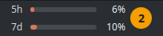

# plasma-claude-usage

A KDE Plasma panel widget (Plasmoid) that shows Claude Code rate-limit usage —
the 5-hour and 7-day windows — as two always-visible progress bars next to the
system clock.



## How it works

Claude Code's status line feature invokes a shell command after each turn,
passing a JSON payload on stdin that includes a `rate_limits` object with both
percentages already computed. That payload is only pushed *transiently* while a
session is active, so a panel widget can't query it on demand.

The bridge is a single cache file, `~/.claude/usage_cache.json`, fed by two
independent writers and read by the widget:

1. **Writer** (`statusline/statusline-command.sh`) — a `statusLine` command
   registered in `~/.claude/settings.json`. It prints the terminal status line
   and atomically writes the two percentages (plus reset timestamps) to the
   cache. Runs only in a terminal session.
2. **Poller** (`poller/usage-poll.sh`) — a systemd user timer that GETs the same
   account-level numbers from Anthropic's OAuth usage endpoint every few minutes,
   independent of any session or surface. This keeps the cache fresh when you
   work through the **VS Code extension** (where `statusLine` never runs) or
   between sessions. See [Data freshness](#data-freshness) below.
3. **Reader** (`plasmoid/`) — the Plasmoid polls that cache file every 2s and
   renders two styled progress bars, independent of whether a session is active.

Both writers report the same account-level quota and write atomically, so they
never conflict — whichever ran most recently is the freshest, and they agree.

### Behavior

- Bars fill in Claude orange (`#D97757`); a window turns red only when it reaches
  100%.
- Between sessions the bars show the last measured values — except a window drops
  to **0%** once its reset time (`resets_at`) passes, since that window has reset
  even without a fresh payload.
- The terminal status line reads e.g. `Opus 4.8 · ctx 5% · 5h 62% · 7d 31%`
  (same orange/red rule). It costs no tokens and is invisible to the model.
See [`docs/design.md`](docs/design.md) for the full design.

## Data freshness

The cache has two writers so the bars stay current across surfaces:

- **In a terminal**, the `statusLine` writer updates the cache every turn — instant.
- **Everywhere else** (the VS Code extension, or no session at all), the systemd
  poller refreshes it every ~3 minutes from the OAuth usage endpoint. `statusLine`
  is a terminal-only feature and no hook carries the numbers, so without the poller
  the bars would freeze during VS Code-only work; the poller closes that gap.

The endpoint (`GET https://api.anthropic.com/api/oauth/usage`) returns the same
account-level 5h/7d utilization that `/usage` shows, authenticated with the OAuth
token Claude Code already stores in `~/.claude/.credentials.json`. It's a
read-only usage query against your **subscription** — it consumes no tokens and
incurs no API spend.

### Adjusting the poll interval

The cadence lives in the timer unit. To change it (for example, to back off if the
endpoint ever rate-limits), edit `OnUnitActiveSec=` in
`poller/claude-usage-poll.timer`, re-run `./install.sh` (the repo copy is the
source of truth), and the reinstall reloads it. To tweak the installed copy
directly without reinstalling:

```
systemctl --user edit --full claude-usage-poll.timer   # change OnUnitActiveSec
systemctl --user daemon-reload && systemctl --user restart claude-usage-poll.timer
```

### When the endpoint breaks

The usage endpoint is **undocumented and can change without notice.** The poller
treats transient problems (offline, timeout, an expired token, a `5xx`) silently —
it just leaves the last-good numbers in place. But if it sees a real break — a
response whose shape it no longer recognises, or a persistent error like `404` —
it raises a **desktop notification** (once per outage, re-armed on recovery) so
you know the bars may be drifting rather than trusting a silently-frozen number.
Details are always in the log:

```
systemctl --user status claude-usage-poll.timer   # is it running?
journalctl --user -u claude-usage-poll -n 20       # why did a run fail?
```

If notifications don't appear (a systemd user service sometimes lacks the session
bus), run once: `systemctl --user import-environment DBUS_SESSION_BUS_ADDRESS`.

## Attention badge

A dot to the right of the bars shows which Claude Code sessions are waiting on
you, across every open session:

- **Amber** — a session is blocked partway through a turn: a permission prompt,
  a question (`AskUserQuestion`), or a plan to approve (`ExitPlanMode`).
- **Faded gray** — every waiting session has finished its turn ("Done").
- A number appears once more than one session is waiting; amber wins whenever
  any session is blocked. Hovering the widget lists the waiting projects
  (each session's working-directory name).

`attention/attention.sh` keeps the state in `~/.claude/attention.json`, a map of
session ID to state, project, and the session's `claude` process. It runs as a
hook on several events:

| Event | Effect |
|---|---|
| `Stop` | marks the session done (shown as "Done") |
| `Notification` | marks it blocked; the 60-second idle reminder is skipped, since it repeats what `Stop` already recorded |
| `PreToolUse` on `AskUserQuestion\|ExitPlanMode` | marks it blocked |
| `PostToolUse`, `UserPromptSubmit`, `SessionEnd` | clears it (a subagent's tool calls leave it alone) |

A session can end without any hook running (a closed terminal tab, a crash), so
the widget's `attention.sh list` call drops every entry whose process has
exited. Each entry stores the process start time with its PID, which keeps a
recycled PID from counting as the old session.

## Install

```
./install.sh
```

This symlinks the writer, the poller, and the attention tracker into `~/.claude/`, installs and enables
the poller's systemd user timer, and installs the Plasmoid as a copied package
(this KDE build rejects symlinked packages). Then:

1. Register the status line in `~/.claude/settings.json`:

   ```json
   "statusLine": {
     "type": "command",
     "command": "/bin/bash ~/.claude/statusline-command.sh"
   }
   ```

2. Register the attention tracker as a hook in `~/.claude/settings.json`, using
   this handler for each event in the table above (with the `matcher` shown for
   `PreToolUse`; `"*"` for `PostToolUse`):

   ```json
   { "type": "command", "command": "bash \"$HOME/.claude/attention.sh\" hook" }
   ```

3. Add the widget to the panel: right-click the panel → **Add Widgets…** →
   search **Claude Usage** → drag it next to the clock.

After editing the Plasmoid, re-run `./install.sh` and reload with
`plasmashell --replace &` — the installed copy does not track the repo.

## Tests

- `bash statusline/test_writer.sh` — the writer (cache write, terminal line,
  coloring, defensive no-clobber, integer rounding).
- `bash poller/test_poll.sh` — the poller (cache write, `utilization`→int rounding,
  ISO→epoch reset times, transient-vs-breakage classification, debounced alert,
  defensive no-clobber).
- `node plasmoid/test_staleness.js` — the staleness helper.
- `bash attention/test_attention.sh` — the attention tracker (marking and
  clearing per event, idle-reminder skip, subagent skip, dead-process and
  recycled-PID pruning).
- `node plasmoid/test_attention.js` — the badge helper.

## Target environment

- **KDE Plasma 5.27** (Qt5) — the Plasmoid uses the Plasma 5 widget API
  (`metadata.json` packaging, `org.kde.plasma.*` QML imports).
- **Claude Code ≥ 1.2.80** — the first version to expose `rate_limits` in the
  status line JSON (populated on `2.1.207`).
